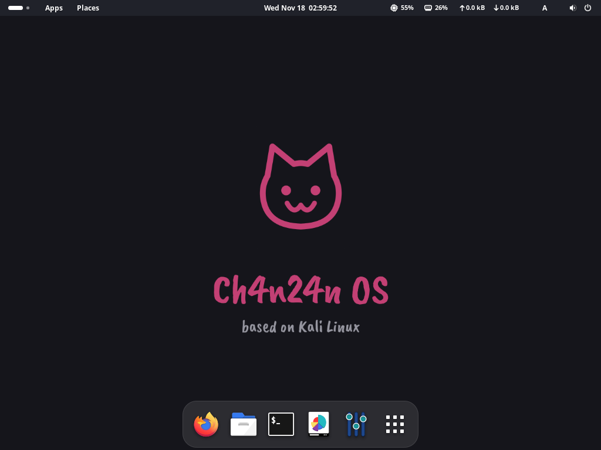
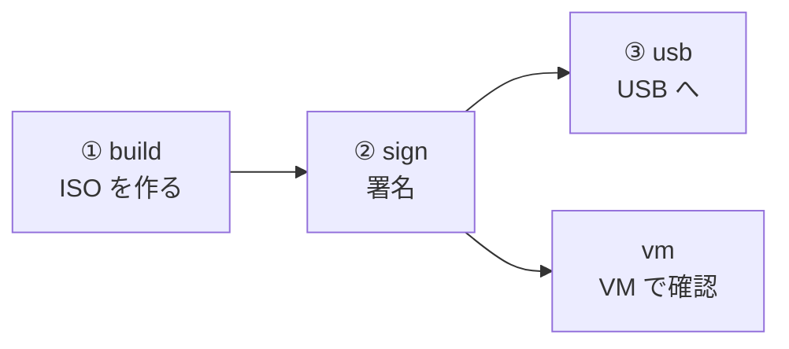

# ch4n24n-os

自分用の Kali の USB OS「Ch4n24n OS」を作る道具です。Kali 公式のビルドに自分用の版を足し、**Secure Boot を切らずに**起動できるよう自分の鍵で署名します。



## 何をするか



- **build** … Kali 公式の kali-live に自分用の版を重ね、`out/` に ISO を作る
- **sign** … UEFI → shim（Debian の署名）→ 自作 GRUB（自分の鍵）→ カーネル（自分の鍵）。初回だけ PC の MokManager で証明書を登録する
- **usb** … 署名した ISO を USB に書き、暗号化した保存領域と exFAT の受け渡し領域を作る（**USB の中身は全部消える**）

## 必要環境

- Kali Linux（ビルドするマシン）。空きディスクに余裕（目安 数十GB）・ネット（パッケージを数GB落とす）
- root: ビルドだけ（`build` が途中で sudo を呼ぶ）。live-build・sbsigntool 等は無ければそこで入れる
- root 不要の部分で使う物: git・python3（PIL・Rsvg）・grub-mkimage・xorriso・mtools・openssl・qemu・ovmf

## インストール

```bash
bash install.sh      # ~/.local/bin に symlink、~/.config/ch4n24n-os（鍵の置き場・700）を作る
```

署名の鍵は、初めての `sign` の前に作ります。

```bash
K=~/.config/ch4n24n-os
openssl req -new -x509 -newkey rsa:2048 -nodes -sha256 -days 36500 -subj "/CN=Ch4n24n OS Secure Boot/" \
  -keyout $K/mok.key -out $K/mok.crt
openssl x509 -in $K/mok.crt -outform DER -out $K/mok.der
chmod 600 $K/mok.key
```

## 使い方

| 操作 | 挙動 |
|---|---|
| `ch4n24n-os build` | 組み立て（prepare）→ sudo でビルド。初回は1時間ほど。結果は `~/work/ch4n24n-os/out/` |
| `ch4n24n-os sign` | 一番新しい ISO を、Secure Boot を切らずに起動できる形にする |
| `ch4n24n-os vm [--sb]` | できた ISO を VM で起動（`--sb` は Secure Boot 有効の PC として） |
| `ch4n24n-os usb /dev/sdX [GiB]` | 署名した ISO を USB に書く。**USB の中身は全部消える** |
| `ch4n24n-os status` | 前回のビルドの終了コードと out/ の中身 |
